# Banking Database DevOps

This project demonstrates the implementation of a Database DevOps workflow for Microsoft SQL Server using SQL Database Projects, DACPAC, GitHub Actions, automated database testing, and Octopus Deploy.

The objective is to automate the database development and deployment lifecycle by treating database schema changes as code. Instead of manually modifying database objects and deploying ad-hoc SQL scripts, this solution uses a version-controlled database project, automated build and validation pipelines, deployable DACPAC artifacts, and automated tests.

The architecture decouples operational and analytical workloads across two isolated databases:
- **BankingDB**: Core OLTP database handling real-time customer accounts and transactions.
- **ReportingDB**: Analytical database that extracts and aggregates transaction metrics from BankingDB via a **SQL Linked Server (`BankingDBServerLink`)** using the `MSOLEDBSQL` OLE DB driver for cross-database queries.

---

## System Architecture

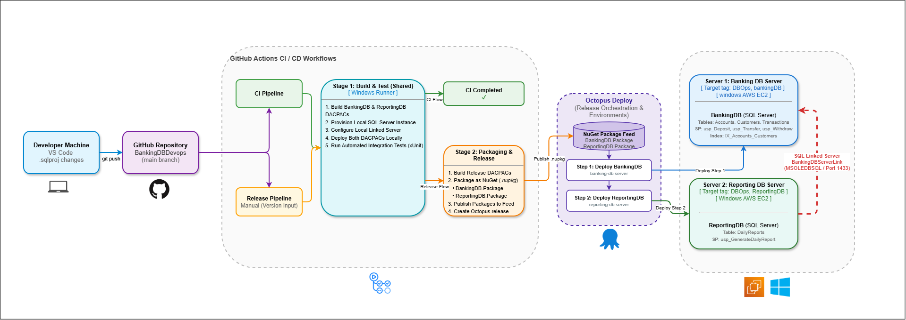

### Tech Stack

| Component | Technology | Role |
|---|---|---|
| **Database Engine** | Microsoft SQL Server 2022 | Hosts transactional and reporting databases |
| **Schema Development** | SQL Database Projects (`.sqlproj`, `Microsoft.Build.Sql`) | Declarative schema definitions |
| **Artifact Format** | DACPAC (`.dacpac`) & NuGet (`.nupkg`) | Versioned schema build & deployment artifacts |
| **Deployment Engine** | SqlPackage CLI | Schema comparison and automated publish |
| **Testing** | C# .NET 9, xUnit | Automated integration & schema validation tests |
| **Source Control** | Git & GitHub | Version control and pull request management |
| **CI/CD Automation** | GitHub Actions | Automated build, test, and package pipelines |
| **Deployment Management** | Octopus Deploy | Environment-aware release and machine-scoped deployments |
| **Cross-Server Integration** | SQL Linked Server (`MSOLEDBSQL`) | Secure communication between ReportingDB and BankingDB |
| **Hosting Infrastructure** | Windows Server (AWS EC2) | Target database host virtual machines |

---

## Project Structure

```
BankingDBDevops/
├── .github/
│   ├── actions/                  # Reusable composite GitHub actions
│   │   ├── buildSQLProject/      # Cleans and builds SQL projects
│   │   └── publishDacpac/        # Deploys DACPACs via SqlPackage
│   └── workflows/
│       ├── CI.yaml               # Pull Request / Manual
│       ├── Release.yaml          # Versioned production release pipeline
│       └── Build_and_Test_Projects.yaml  # Reusable core build & test job
├── Build/
│   ├── BuildProject.ps1          # Compiles SQL projects into DACPAC
│   ├── CleanProject.ps1          # Cleans output artifacts
│   ├── CreateLinkServer.ps1      # Automated SQL Linked Server setup
│   ├── PublishDacpacFile.ps1     # SqlPackage CLI wrapper
│   └── Pack-DatabaseNuGet.ps1    # Automated dotnet pack wrapper
├── DataBaseTests/                # Integration test suite (xUnit + Dapper)
│   ├── LinkedServerSetupTests.cs # Validates linked server health & connectivity
│   └── SchemaColumnTests.cs      # Validates schema integrity, types, constraints
├── Operations/                   # Operational scripts, queries, and diagnostics
│   └── Diagnostics/              # Linked server checks and reporting tests
│       ├── create_linkserver.sql
│       └── verify_reporting_and_linkserver.sql
├── Source/
│   ├── BankingDB/                # OLTP Database Project (SDK-style .sqlproj)
│   │   ├── dbo/Tables/           # Accounts, Transactions tables
│   │   └── Deploy.ps1            # Octopus entry point for BankingDB
│   └── ReportingDB/              # OLAP Database Project (SDK-style .sqlproj)
│       ├── dbo/StoredProcedures/ # usp_GenerateDailyReport (cross-server SP)
│       ├── dbo/Tables/           # DailyReports aggregation table
│       └── Deploy.ps1            # Octopus entry point for ReportingDB
└── Docs/                         # Architecture diagrams & proof of work
```

---

## Configuration & Variables Reference

### 1. GitHub Actions (Secrets & Variables)

Configure these in **GitHub → Settings → Secrets and variables → Actions**:

| Name | Type | Purpose | Example Value |
|---|---|---|---|
| `LOCAL_MSSQL_SA_USERNAME` | Variable | Local test runner SQL username | `sa` |
| `LOCAL_MSSQL_SA_PASSWORD` | Secret | Local test runner SQL SA password | `StrongPassword123` |
| `BANKINGDB_LINKSERVERNAME` | Variable | Name of the linked server during CI testing | `BankingDBServerLink` |
| `OCTOPUS_FEED_URL` | Variable | Push endpoint for Octopus built-in feed | `https://your-octopus.instance` |
| `OCTOPUS_FEED_API_KEY` | Secret | Octopus API key for publishing packages | `API-XXXXXXXXXXXXXXXXXXXXXXXXXXXX` |

---

### 2. Octopus Deploy Variables

Variables follow the naming convention **`DB_<DatabaseName>_<Property>`** and are scoped per environment (**Development**, **Staging**, **Production**):

| Variable Name | Sensitive? | Target Step | Description |
|---|---|---|---|
| `DB_BankingDB_Server` | No | Step 1 (BankingDB) | Hostname / IP of Banking SQL Server (e.g. EC2 instance) |
| `DB_BankingDB_Name` | No | Step 1 & 2 | Target database name (`BankingDB`) |
| `DB_BankingDB_Username` | No | Step 1 (BankingDB) | SQL deployment user |
| `DB_BankingDB_Password` | **Yes** | Step 1 (BankingDB) | SQL deployment password |
| `DB_ReportingDB_Server` | No | Step 2 (ReportingDB) | Hostname / IP of Reporting SQL Server |
| `DB_ReportingDB_Name` | No | Step 2 (ReportingDB) | Target database name (`ReportingDB`) |
| `DB_ReportingDB_Username` | No | Step 2 (ReportingDB) | SQL deployment user |
| `DB_ReportingDB_Password` | **Yes** | Step 2 (ReportingDB) | SQL deployment password |
| `DB_BankingDB_LinkServer`| No | Step 2 (ReportingDB) | Name of configured Linked Server (`BankingDBServerLink`) |

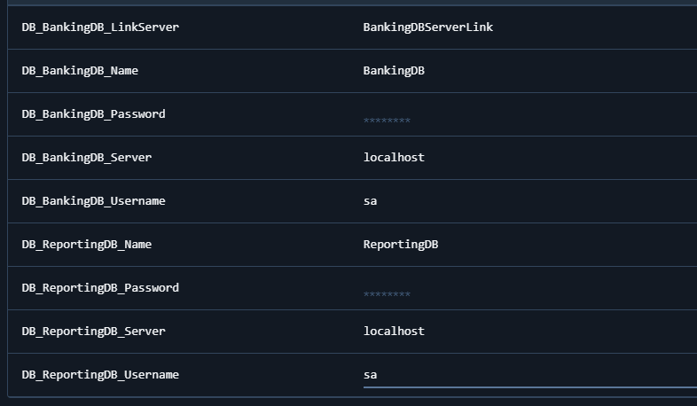
---

## Local Development & Commands

```powershell
# Build SQL Projects (compiles .dacpac)
dotnet build Source/BankingDB/BankingDB.sqlproj -c Release
dotnet build Source/ReportingDB/ReportingDB.sqlproj -c Release /p:BankingDatabaseName=BankingDB

# Package into NuGet (.nupkg) with Deploy.ps1
./Build/Pack-DatabaseNuGet.ps1 -ProjectName "BankingDB"  -Version "1.0.0"
./Build/Pack-DatabaseNuGet.ps1 -ProjectName "ReportingDB" -Version "1.0.0"

# Clean build outputs
dotnet clean Source/BankingDB/BankingDB.sqlproj -c Release
dotnet clean Source/ReportingDB/ReportingDB.sqlproj -c Release

# Run automated integration tests
dotnet test DataBaseTests/DataBaseTests.csproj
```

---

## Execution Evidence

### 1. Automated Release Trigger & CI Verification
The release workflow is triggered manually with a version input. Stage 1 compiles the DACPACs and runs integration tests against an ephemeral SQL instance.

| Triggering Release Workflow | Pipeline Execution Success |
|---|---|
| 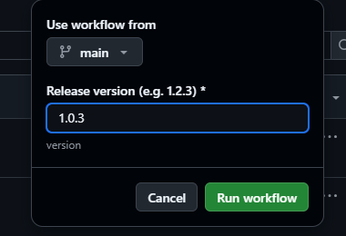 | 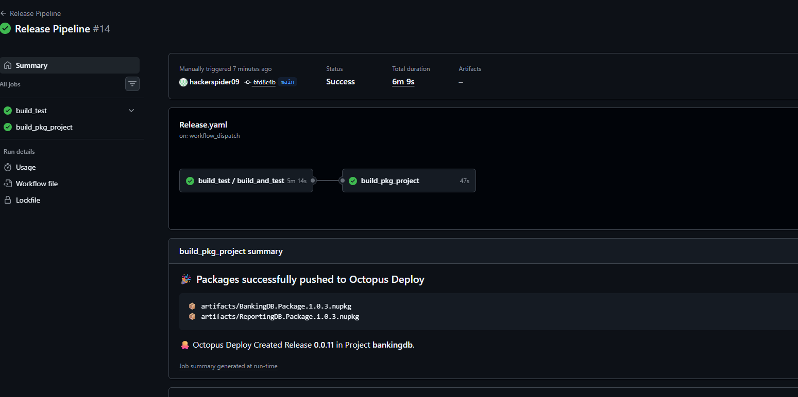 |

---

### 2. Package Creation & Release Tagging
Versioned `.nupkg` packages are created and pushed to the feed, and a corresponding GitHub Release tag is published.

| Octopus Builtin Feed | Banking DB Pkg | Reporting DB Pkg |
|---|---|---|
| 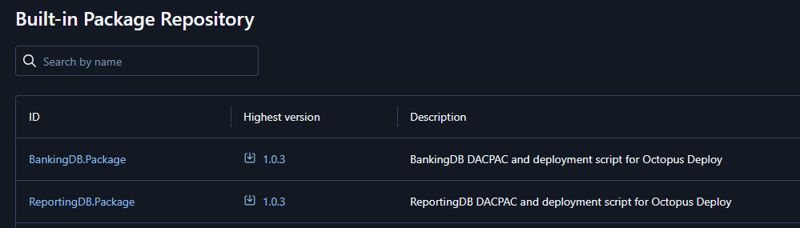 | 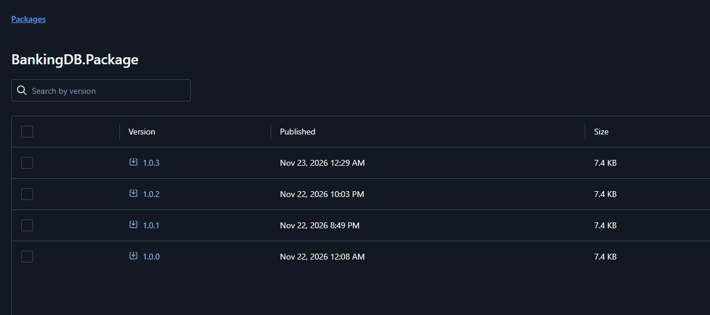 | 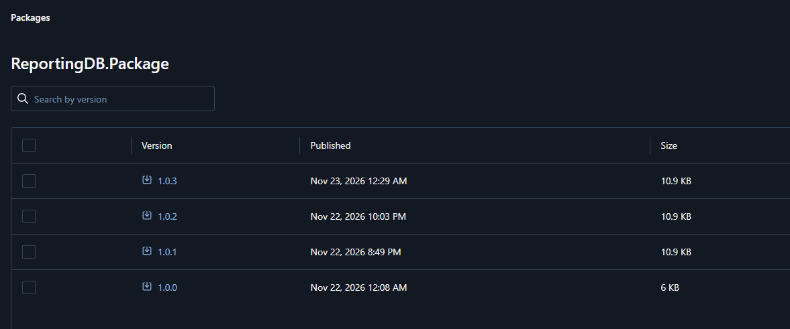 |

| Release created and tagged with SHA|
|---|
| 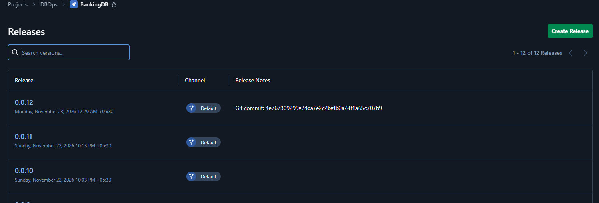 |

| Octopus Deployment Before (0.0.10) | Octopus Deployment After Release (0.0.11) |
|---|---|
| 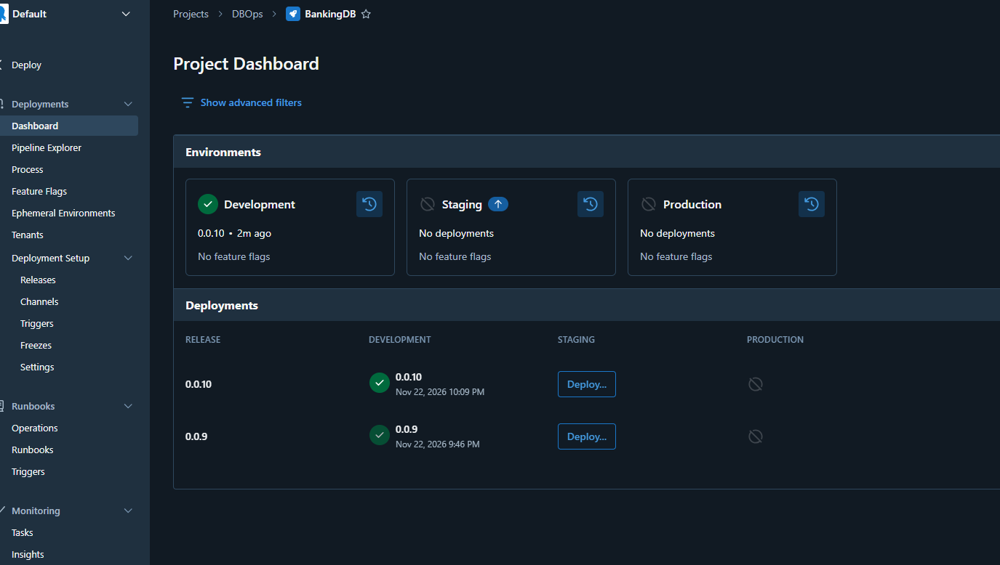 | 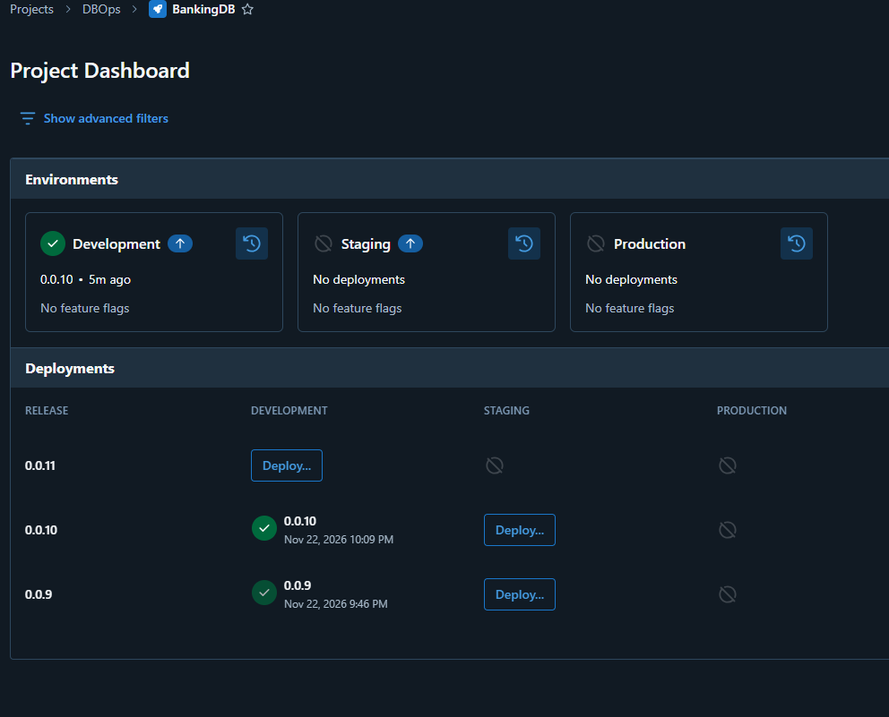 |

---

### 3. Octopus Deployment Orchestration
Octopus targets dedicated machine roles (`BankingDB` and `ReportingDB`), extracts the packages, and runs `Deploy.ps1` using SqlPackage.

| Octopus Deployment Process |
|---|
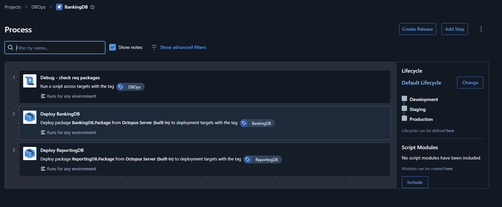

| Octopus Deployment Log |
|---|
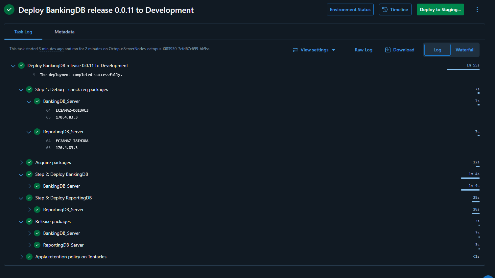

---

### 4. Target Infrastructure & Machine Scoping
Deployments are scoped to roles across dedicated AWS EC2 Windows instances running isolated SQL Server workloads.

| Octopus Machine Roles | Cloud Infrastructure (AWS EC2) |
|---|---|
| 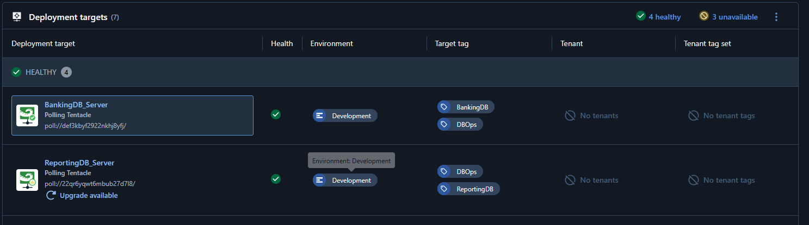 | 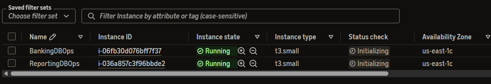 |

---

### 5. Post-Deployment Database & Linked Server Verification
Schemas and tables are verified across both instances. Stored procedures execute across `BankingDBServerLink` to pull transaction data into `ReportingDB`.

| BankingDB Tables Verified | ReportingDB Tables Verified |
|---|---|
| 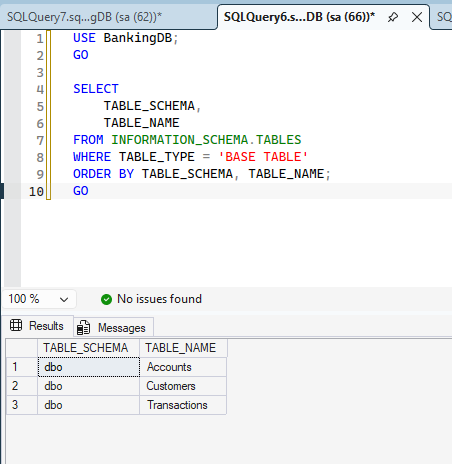 | 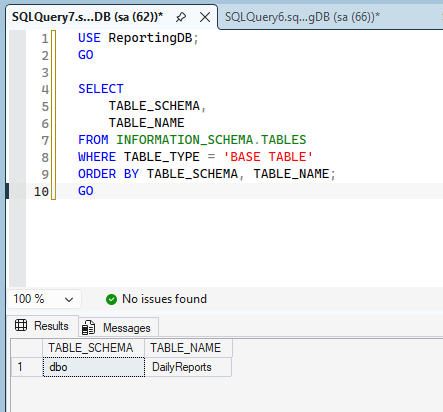 |

| SQL Linked Server Accessibility |
|---|
| 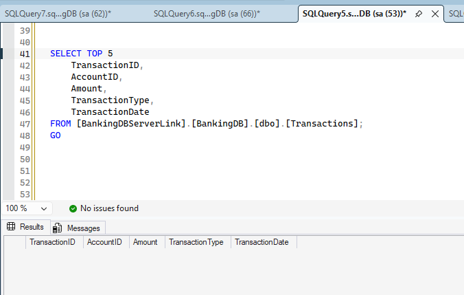 |

---

## Machine Setup Notes

Quick setup reference for provisioning target machines and testing locally:

### 1. Required Software & Download Links
- **SQL Server 2022**: [Download Evaluation / Developer](https://www.microsoft.com/en-us/evalcenter/download-sql-server-2022)
- **SqlPackage CLI**: [Download SqlPackage](https://learn.microsoft.com/en-us/sql/tools/sqlpackage/sqlpackage-download?view=sql-server-ver17)
- **Octopus Tentacle**: [Download Tentacle](https://octopus.com/downloads/tentacle)
- **Microsoft OLE DB Driver for SQL Server (MSOLEDBSQL)**: [Download Driver](https://learn.microsoft.com/en-us/sql/connect/oledb/download-oledb-driver-for-sql-server?view=sql-server-ver17)
- **Visual C++ Redistributables (Required by OLE DB Driver)**: [Download VC++ Redistributable (x64 and x86)](https://learn.microsoft.com/en-us/cpp/windows/latest-supported-vc-redist?view=msvc-170#latest-supported-redistributable-version)

---

### 2. SQL Server Configuration
1. **Installation**: Choose Custom Installation $\to$ select **Database Engine Services**.
2. **Authentication Mode**: Select **Mixed Mode (SQL Server and Windows Authentication)**, set a strong `sa` password, and add the current Windows user as SQL administrator.
3. **Enable TCP/IP**:
   - Open **SQL Server Configuration Manager** $\to$ *SQL Server Network Configuration* $\to$ *Protocols for MSSQLSERVER*.
   - Right-click **TCP/IP** and set to **Enabled**.
4. **Restart & Check Service**:
   ```powershell
   Restart-Service MSSQLSERVER
   Get-Service MSSQLSERVER
   ```

---

### 3. Windows Firewall Configuration (Port 1433)
Open inbound port 1433 so remote machines and the linked server can communicate:

```powershell
New-NetFirewallRule `
  -DisplayName "SQL Server TCP 1433" `
  -Direction Inbound `
  -Protocol TCP `
  -LocalPort 1433 `
  -RemoteAddress Any `
  -Action Allow
```

---

### 4. OLE DB Driver Installation (Reporting DB Server)
The Reporting server needs the OLE DB driver to communicate with the Banking server via Linked Server:
1. Install both **Visual C++ Redistributable (x64)** and **Visual C++ Redistributable (x86)**.
2. Install **Microsoft OLE DB Driver for SQL Server** (`MSOLEDBSQL`).
3. Restart the SQL Server service:
   ```powershell
   Restart-Service MSSQLSERVER
   ```

---

### 5. SqlPackage Installation

You can install SqlPackage using either of the following two methods:

#### Method 1: Manual ZIP Download (Direct)
1. Download the `SqlPackage` .zip file and extract it to `C:\Program Files\SqlPackage`.
2. Add `C:\Program Files\SqlPackage` to the system-wide **Machine** PATH environment variable.

#### Method 2: Using .NET Tool (`dotnet tool`)
Install the .NET SDK, then install SqlPackage. 

> [!NOTE]
> Installing globally via `dotnet tool install -g microsoft.sqlpackage` only registers the executable under the current Administrator's user profile (`%USERPROFILE%\.dotnet\tools`), meaning the Octopus Tentacle service running under a different service account will not find it.
> 
> To make it available **system-wide for all users and background services**, install to a shared folder and update the Machine PATH:

```powershell
# 1. Install tool to shared directory
dotnet tool install --tool-path "C:\Program Files\SqlPackage" microsoft.sqlpackage

# 2. Add to system-wide Machine PATH (accessible by all users and Tentacle service)
# (Note: You can also do this via Windows GUI: System Properties -> Environment Variables -> System variables -> Path -> New)
$newPath = "C:\Program Files\SqlPackage"
$currentPath = [Environment]::GetEnvironmentVariable("Path", "Machine")
if ($currentPath -notlike "*$newPath*") {
    [Environment]::SetEnvironmentVariable("Path", "$currentPath;$newPath", "Machine")
}
```

#### Post-Installation Step (Required for Both Methods)
Restart the Octopus Tentacle service (via Octopus Tentacle Manager or PowerShell) so it reloads the updated system PATH:
```powershell
Restart-Service "OctopusDeploy Tentacle"
```

---

### 6. Octopus Tentacle & API Permissions
- **Tentacle Setup**: Install as a Polling or Listening Tentacle and assign target roles:
  - `BankingDB` (for Banking SQL machine)
  - `ReportingDB` (for Reporting SQL machine)
  - `DBOps`
- **Octopus API Key Permissions**:
  - **For GitHub Actions**: Package Publisher + Project Viewer + Release Creator.
  - **For Tentacle**: Environment Manager + Project Viewer.
